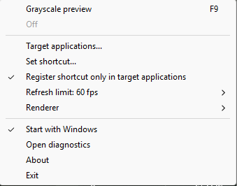

# CSP Grayscale Viewer

[English](README.md) | [繁體中文](README.zh-TW.md) | [简体中文](README.zh-CN.md) | [日本語](README.ja-JP.md)

Clip Studio Paint などの描画アプリで明暗を確認するための、Windows ネイティブのトレイツールです。マウスやペン入力はプレビューを通過します。作品の変更や描画アプリへのコード注入は行いません。

**バージョン 1.1.0** · [変更履歴](CHANGELOG.md)

## 使い方

1. [Releases](../../releases) からインストーラーかポータブル版を入手するか、下記の手順でビルドします。
2. `CSP-Grayscale-Viewer.exe` を実行すると、Windows の通知領域にアイコンが表示されます。
3. Clip Studio Paint に切り替え、**F9** でプレビューを切り替えます。アイコンの左クリックでも切り替えられます。
4. 右クリックメニューから対象アプリ、ショートカット、更新上限、レンダラー、自動起動を設定でき、診断ログの表示や終了も行えます。

対象アプリとショートカットは、必要時だけ作成されるネイティブのダイアログで編集します。初期設定では対象アプリにフォーカスがある間だけショートカットを登録します。新しいキーが競合した場合、以前の割り当てを維持します。Win 修飾キーに対応し、Windows 予約キーの F12 は使用できません。

## 描画

新しいプロファイルは **Direct3D**、上限 60 fps を使用します。キャプチャとトレイ更新はバックグラウンドで処理し、ショートカットを妨げません。非表示時は描画を停止し、一部の描画リソースを保持して再表示を高速化します。フォーカス通知を取り逃した場合はショートカットを自動的に復旧します。

**Magnification** は手動選択できる互換モードです。Direct3D のキャプチャ失敗、画面をまたぐウィンドウ、回転したディスプレイでは自動的に切り替えます。最大化したウィンドウの非表示の枠は複数画面と誤判定しません。現在のモードはトレイメニューに表示されます。

- **Automatic** は対象ディスプレイのリフレッシュレートに追従し、手動指定もそのレートを上限とします。Direct3D は最大 144 fps、Magnification は最大 100 fps で、達成を保証する値ではありません。
- Direct3D には Windows 10 2004 以降が必要です。旧版では互換モードを使用します。
- HDR、保護されたコンテンツ、リモート接続、複数 GPU、実際のペン遅延は対応する環境での検証が必要です。

## 設定の移行

更新前に、実行中のアプリをトレイメニューから終了してください。その後、上書きインストールするかポータブル版のファイルを置き換えます。同じ設定プロファイルでは一つのインスタンスだけが動作するため、旧版の実行中に別のコピーを開いても旧版が使われます。ポータブル版を移動した場合は、新しい場所から **Start with Windows** を一度オフにして再度オンにし、自動起動のパスを更新してください。

設定を検証し、原子的なファイル置換で `%APPDATA%\CSP-Grayscale-Viewer\native-settings.ini` に保存します。初回起動時は同じフォルダーの旧 `settings.ini` を読み込み、元ファイルとレンダラーの選択を維持します。従来の設定ウィンドウと最小化起動オプションに代わり、起動時からトレイに常駐します。

`Open diagnostics` は件数制限付きのメモリ内ログを設定ファイルの隣へ書き出します。通常終了時にも `diagnostics.log` として保存し、実行ファイルのパス、ビルド日時、設定ファイルのパス、時刻と受信したショートカットを記録します。常駐ログウィンドウや継続的なディスク書き込みは不要です。

独立したプロファイルを使う場合：

```powershell
.\CSP-Grayscale-Viewer.exe --settings .\test-settings.ini --configure
```

## ビルドとテスト

Windows 10/11 x64、Visual Studio 2022 の C++ デスクトップ開発環境と Windows SDK、CMake 3.20 以降が必要です。Qt や MSVC ランタイムの別途インストールは不要です。

```powershell
.\scripts\test.ps1 -Configuration Release -Smoke
```

出力先は `build/native/Release` です。GUI の実行ファイルは単体で使用できます。任意の `_Console.exe` は既定の設定で動作し、コンソールにログを出力します。Inno Setup 6 はインストーラー作成時だけ必要です。

Debug、デスクトップ描画テスト、手動確認については[テストと構成の説明](docs/testing.md)を参照してください。Windows CI は Debug と Release の回帰テストおよびトレイ起動テストを実行します。

## デモとライセンス

v1.1.0 のネイティブトレイメニュー：




デモ内の設定画面は、ネイティブトレイへの移行前のものです。

[MIT License](LICENSE)。
