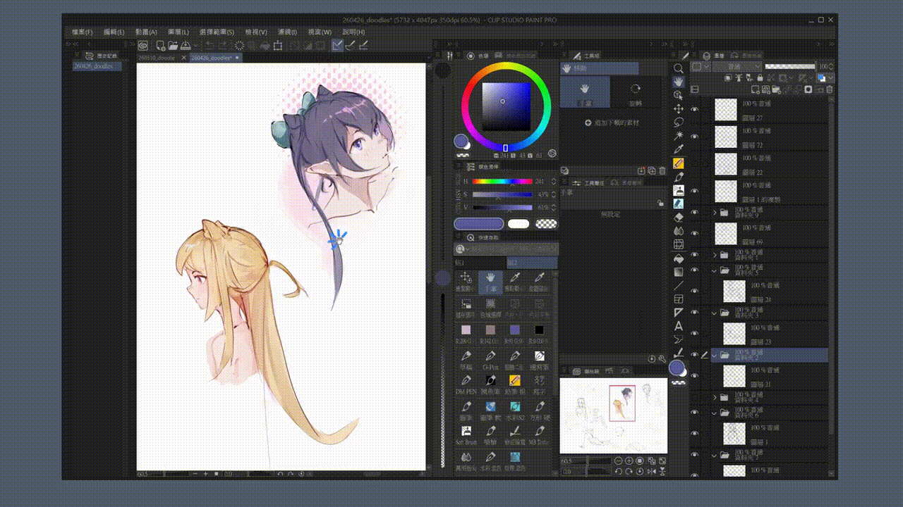

# CSP Grayscale Viewer

[English](README.md) | [繁體中文](README.zh-TW.md) | [简体中文](README.zh-CN.md) | [日本語](README.ja-JP.md)

Windows 原生托盘灰度预览工具，适用于 Clip Studio Paint 和其他绘图软件。覆盖层允许鼠标与绘图笔输入穿透，不会修改作品，也不会向绘图软件注入代码。

**版本 1.1.0** · [版本记录](CHANGELOG.md)

## 使用

1. 从 [Releases](../../releases) 下载安装版或便携版，或自行构建。
2. 运行 `CSP-Grayscale-Viewer.exe`，图标会出现在 Windows 通知区域。
3. 切换到 Clip Studio Paint，按 **F9** 开关预览；左键点击托盘图标也可切换。
4. 右键菜单可设置目标程序、快捷键、刷新上限、渲染器、开机启动，以及打开诊断或退出。

目标程序和快捷键使用按需创建的原生对话框。默认仅在目标程序获得焦点时注册快捷键。新快捷键冲突时保留原绑定；支持 Win 修饰键，F12 为 Windows 保留键。

## 渲染

新配置默认使用 **Direct3D**，刷新上限为 60 fps。捕获与托盘更新在后台执行，避免阻塞快捷键。隐藏预览后停止渲染，并缓存部分图形资源以加快重新开启。焦点通知遗漏时会自动恢复快捷键。

**Magnification** 保留为可手动选择的兼容模式。Direct3D 捕获失败、窗口跨屏或显示器旋转时自动回退；最大化窗口的隐藏边框不会被误判为跨屏。托盘菜单显示当前模式。

- **Automatic** 跟随目标显示器刷新率，手动设置也不会超过该刷新率。Direct3D 最高 144 fps，Magnification 最高 100 fps，并非保证达到的帧率。
- Direct3D 需要 Windows 10 2004 以上，旧版本使用兼容模式。
- HDR、受保护内容、远程桌面、多显卡及实际绘图笔延迟仍需在相应环境验证。

## 设置迁移

升级前请先从托盘退出正在运行的程序，再覆盖安装或替换便携版文件。每个配置文件只允许运行一个实例；旧版仍在后台时，打开另一份程序会沿用旧版。移动便携版位置后，请从新位置将 **Start with Windows** 关闭再开启，以更新启动路径。

配置先验证，再通过原子替换保存到 `%APPDATA%\CSP-Grayscale-Viewer\native-settings.ini`。首次启动原生版会导入同目录的旧 `settings.ini`，保留原文件及原渲染器偏好。程序启动后直接驻留托盘，取代旧设置窗口和启动时最小化选项。

`Open diagnostics` 将有数量上限的内存日志导出到配置文件旁；正常退出时也会保存为 `diagnostics.log`，包含执行路径、构建时间、配置文件路径、事件时间与收到的快捷键事件。不需要常驻日志窗口或持续写入磁盘。

```powershell
.\CSP-Grayscale-Viewer.exe --settings .\test-settings.ini --configure
```

以上命令使用独立配置文件。

## 构建和测试

需要 Windows 10/11 x64、Visual Studio 2022 的 C++ 桌面开发组件和 Windows SDK，以及 CMake 3.20 以上。不需要 Qt 或单独安装 MSVC 运行时。

```powershell
.\scripts\test.ps1 -Configuration Release -Smoke
```

输出位于 `build/native/Release`。GUI 可执行文件可独立使用；可选的 `_Console.exe` 使用默认配置并输出控制台日志。仅打包安装程序时需要 Inno Setup 6。

Debug、桌面渲染集成测试和手动检查见[测试及架构说明](docs/testing.md)。Windows CI 执行 Debug／Release 核心回归测试和托盘启动测试。

## 演示和许可



演示中的设置界面属于原生托盘改版前的版本。

[MIT License](LICENSE)。
